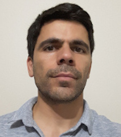
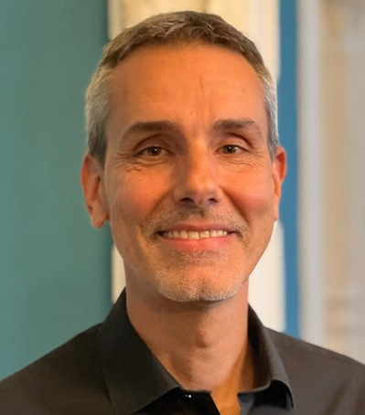
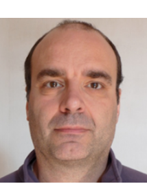
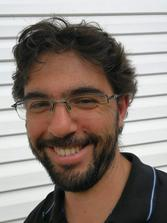
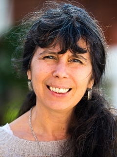

Please send your comments, questions or suggestions to the public
user group GINsim Users at [ginsim-users@googlegroups.com](mailto:ginsim-users@googlegroups.com).

As some problems might be difficult to reproduce, try to include a description of the problem and steps to reproduce it. If possible provide log traces (using the GINsim/support/export log traces menu entry) and to launch GINsim from the [command line](../install/index.md#running-ginsim) to catch additional error messages.

Specific questions can also be adressed to the GINsim team at [Pedro.Tiago.Monteiro@tecnico.ulisboa.pt](mailto:Pedro.Tiago.Monteiro@tecnico.ulisboa.pt).

## Meet the current team

    

        

             
            <a href="http://pedromonteiro.org">Pedro T. Monteiro</a> 
            Software development
        

        

             
            <a href="https://mabios.math.cnrs.fr/perso/tichit.html">Laurent Tichit</a> 
            Software development
        

        

             
            <a href="https://www.ibens.ens.fr/spip.php?rubrique27">Denis Thieffry</a> 
            Project coordination
        

    

## Former contributors

    

        

             
            <a href="http://aurelien.naldi.info">Aur&eacute;lien Naldi</a>
            was the main developer of GINsim code, as well as one of the main contributors of the methods available. Still helps from time to time :)
        

        

             
            Claudine Chaouiya (1961-2025) co-directed the GINsim project since its initiation in 2002 and strongly pushed the development of this new release, before she passed away in September 2025.
        

    

Also, numerous students, researchers and engineers worked and/or collaborated in the development of GINsim's features:

- Prototype development: Frederic Cordeil, Thomas Marcq, Cecile Menahem, Romain Muti
- Biological applications: Adrien Fauré, Aitor Gonzalez
- Software development: Duncan Berenguier, Fabrice Lopez, Kevin Mathieu, Rui Henriques, Nuno D. Mendes, Lionel Spinelli, Olivier Chabrol, Dominique Benielli

The GINsim logo was designed by [Mauricio Guzman](http://www.altamirastudio.com.mx/).

---
GINsim is currently hosted at:

- [GitHub Pages](https://pages.github.com/), under `https://ginsim.github.io/`

It was previously hosted at:

- TAGC, Université de la Méditerranée, FR, under `http://gin.univ-mrs.fr/GINsim`
- IGC, Oeiras, PT, under `http://ginsim.org`
- INESC-ID, Lisbon, PT, under `http://ginsim.org`

