# Tutorial: from a regulatory graph to dynamical analysis with GINsim 3.1

This tutorial walks you through the main steps of a logical modelling project with GINsim 3.1:
defining a regulatory graph and its logical rules, checking them, computing attractors,
exploring the dynamics, estimating attractor reachability and analysing regulatory circuits.

It has two parts:

* **Part I** builds a small model *from scratch*, the p53–Mdm2 network (four components, two of them multilevel), following the
  protocol of Naldi *et al.* [^naldi2018], so that you can practise the editing tools and the main analyses on something
  small whose behaviour you can fully predict.
* **Part II** applies the analysis tools to a published model, the multilevel model of the mammalian
  cell cycle by Traynard *et al.* [^traynard], which is the case study of the GINsim 3.1 article.
  The screenshots of Part II are the figures of that article.

!!! info "Before you start"
    * **Software:** GINsim 3.1, which needs a Java Virtual Machine (version 11 or later). See the [installation page](/install/).
    * **File for Part I:** the complete p53–Mdm2 model (to check your work, or to start from), available from the [model repository](/models/2009-mammal-p53-mdm2/) (file `p53Mdm2_tutorial_5march2018.zginml`).
    * **Files for Part II:** the multilevel cell cycle model, available from the
      [model repository](/models/2016-mammal-cell-cycle/) (file `Traynard_MultiLevel_MamCC_Apr2016.zginml`).
    * **Reference documentation:** this tutorial is task-oriented. The full description of every
      functionality is in the [Documentation](/documentation/).


---

## Getting started

### Launching GINsim

Start GINsim from your file browser (double-click on the JAR file) or from a terminal:

```
java -jar GINsim-<version>.jar
```

GINsim opens the *Welcome* dialog, from which you can create a **New model**, **Open** a saved model,
or **Import** a model from another format. The recently used files are listed below.

!!! example "The Welcome dialog"
    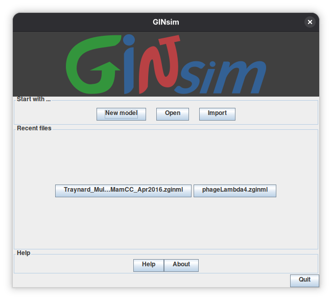{ width="420" }

    Closing this dialog stops GINsim.

!!! tip "Opening a file from the command line"
    A model file (or a request for a new model) can be given as an argument on the command line,
    in which case the Welcome dialog is skipped. For example, from the directory containing both files:

    ```bash
    java -jar GINsim-3.1-with-deps-java11.jar Traynard_MultiLevel_MamCC_Apr2016.zginml
    ```

    Use the JAR matching your Java version and replace the model filename with the path to the file you want to open.
    See the run options on the [installation page](/install/).

### The main window

Every model opens in a *main window*. From top to bottom you find the menus
(`GINsim`, `File`, `View`, `Graph`, `Tools`), the editing toolbar, the graph canvas,
and the bottom area with the three tabs (whose content depends on the selected element)
**Modelling Attributes**, **Style**, and **Annotation**.

!!! example "The main window of a new model"
    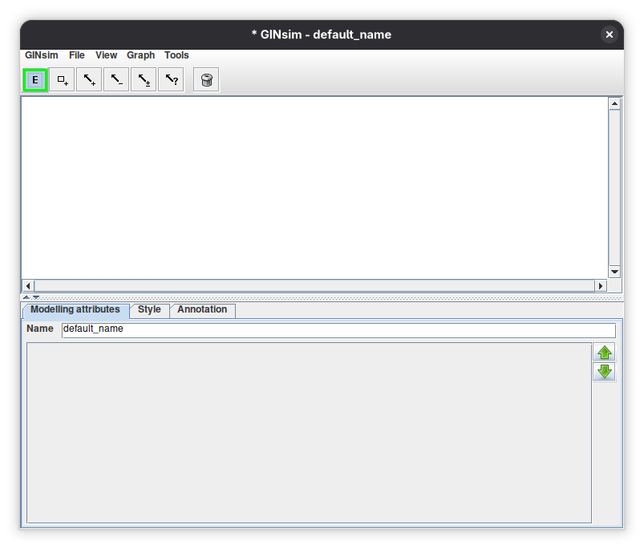{ width="560" }

The functionalities used in this tutorial are located as follows.

| Menu | Entries used in this tutorial |
|------|-------------------------------|
| `Tools` | *Run simulation*, *Attractor reachability*, *Compute stable states*, *Trap-spaces identification*, *Analyse circuits*, *Interactions functionality*, *Reduce model*, *Booleanize model*, *Reverse model* |
| `Graph` | *Colour LRG*, *Colour SCC*, *Construct SCC Graph*, *Find path* |
| `File` | *New model*, *Open*, *Import*, *Save*, *Save as…*, *Export*, *Close* |
| `View` | *Layout*, zoom commands |

!!! example "The Tools and Graph menus"
    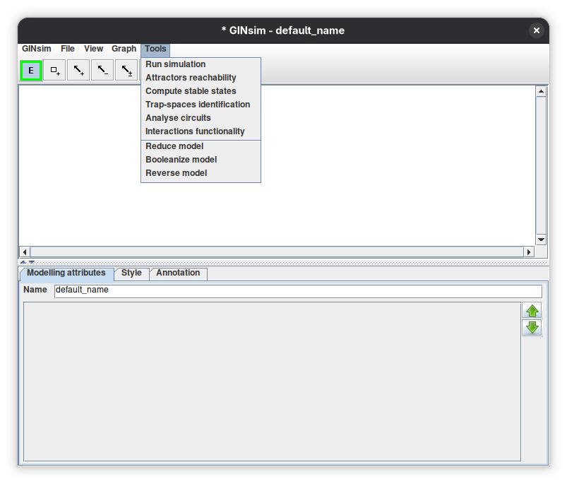{ width="360" }
    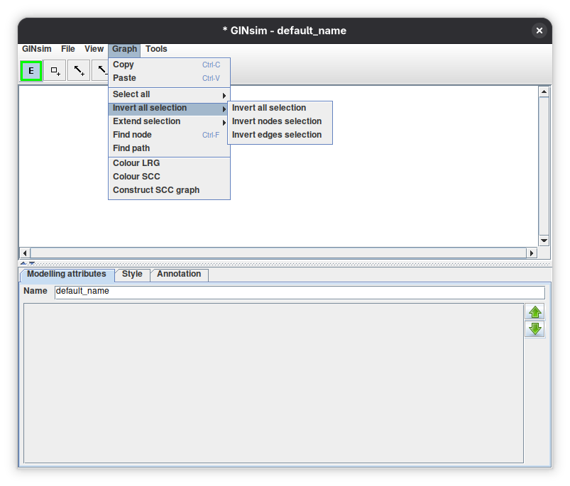{ width="360" }

---

## Part I: building a model from scratch, the p53–Mdm2 network

In this first part we build, step by step, a small logical model of the **p53–Mdm2 network** and analyse it
with the main GINsim tools. We follow the protocol of Naldi *et al.* [^naldi2018], which uses
the same example, and which you can read for more biological and methodological background.


### The biological system

The transcription factor p53 controls cell proliferation and the response to DNA damage. Its level is tightly regulated
by the ubiquitin ligase Mdm2: nuclear Mdm2 accelerates the degradation of p53 and blocks its transcriptional activity.
In turn, p53 activates the transcription of Mdm2 and, by inhibiting the translocation of Mdm2 from the cytoplasm to the nucleus,
decreases the level of nuclear Mdm2. DNA damage promotes the degradation of Mdm2, so that p53 can increase and
trigger DNA repair; high levels of p53 in turn favour the repair of the damage.

!!! example "The p53–Mdm2 network"
    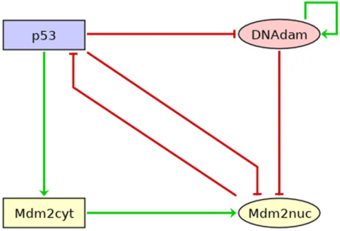{ width="400" }

### The model

The model has four components, whose maximal levels are given below. **Please create them in this order**
(p53, Mdm2cyt, Mdm2nuc, DNAdam), which makes your results easier to compare with the figures.

| Component | Meaning | Levels |
|-----------|---------|--------|
| `p53` | the protein p53 | 0, 1, 2 |
| `Mdm2cyt` | Mdm2 in the cytoplasm | 0, 1, 2 |
| `Mdm2nuc` | Mdm2 in the nucleus | 0, 1 |
| `DNAdam` | DNA damage | 0, 1 |

The regulatory interactions are listed below. When a source acts on a target at several levels (here Mdm2cyt on Mdm2nuc),
the interaction has several *thresholds*, each of them with its own sign. An interaction is active when the level of its source
is at least its threshold, and below the threshold of the next interaction of the same source.

| Source | Target | Threshold | Sign |
|--------|--------|-----------|------|
| p53 | Mdm2nuc | 1 | − |
| p53 | Mdm2cyt | **2** | + |
| p53 | DNAdam | **2** | − |
| Mdm2cyt | Mdm2nuc | 1 | + |
| Mdm2cyt | Mdm2nuc | **2** | + |
| Mdm2nuc | p53 | 1 | − |
| DNAdam | DNAdam | 1 | + |
| DNAdam | Mdm2nuc | 1 | − |

Finally, the logical rules give the conditions under which each component is called to reach a target level.

* `p53`, target level 2: `!Mdm2nuc`
* `Mdm2cyt`, target level 2: `p53`
* `Mdm2cyt`, target level 1: `!p53`
* `Mdm2nuc`, target level 1: `Mdm2cyt:2 | (Mdm2cyt:1 & !p53 & !DNAdam)`
* `DNAdam`, target level 1: `DNAdam & !p53`

Rules combine regulators with `!` (NOT), `&` (AND), `|` (OR) and parentheses. A regulator name refers to
an interaction, and is true when the level of the regulator is at least the threshold of this interaction. When there are
several thresholds, `Mdm2cyt:2` explicitly designates the one at level 2. Hence, in the rule of `Mdm2cyt`, `p53` means
"p53 at level 2" (threshold 2 of the interaction p53 → Mdm2cyt), and `!p53` means "p53 below level 2", whereas in the rule of
`Mdm2nuc`, `!p53` means "p53 absent" (threshold 1).

In words:

* p53 is called to its highest level when there is no nuclear Mdm2, and to 0 otherwise;
* Mdm2cyt has a basal level of 1, and is called to level 2 when p53 is at level 2;
* Mdm2nuc is active when Mdm2cyt is at level 2, or when Mdm2cyt is at least at level 1 in the absence of p53 and of DNA damage;
* DNAdam maintains itself, unless p53 reaches level 2 (DNA repair).

A level not covered by any rule is called to 0.

### Create the components

1. In the *Welcome* dialog, click **New model**.
2. Use the *component insertion* tool of the toolbar (a square with a plus sign). To create several nodes in a row,
   **double-click** the tool to lock the mode, then click four times on the canvas. Click the **E** button (default mode) to stop adding nodes.
3. Select each node and use the bottom panel (*Modelling Attributes* tab) to set its `Id` and its maximal level `Max`
   (2 for p53 and Mdm2cyt, 1 for the others), as in the table above. Leave the `Input` box unticked: this model has no input.
4. Check the order of the components: with nothing selected, the *Modelling Attributes* tab lists the components. Use the green arrows to obtain the order:
   p53, Mdm2cyt, Mdm2nuc, DNAdam.

!!! example "Defining the components"
    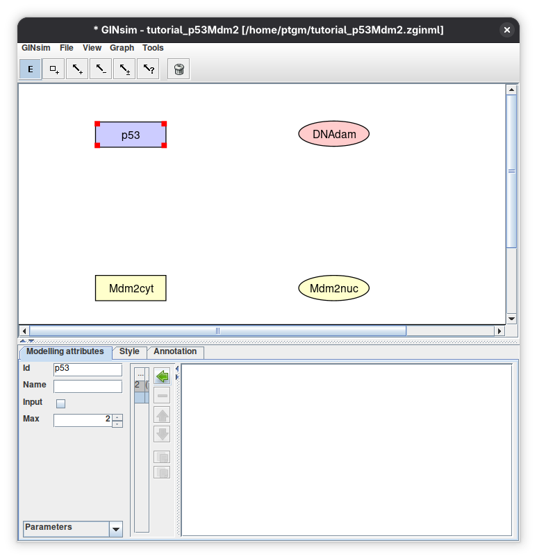{ width="640" }

    The four nodes created; here p53 is selected, and the bottom panel shows its identifier, its maximal level (2), and its annotations.
    The *Style* tab lets you change colours and shapes.

!!! tip "Editing tools"
    Pass the mouse over a tool to display its function. Clicking once on a tool selects it for a single use; clicking twice locks it.
    { width="380" }

### Add the interactions

Select the type of interaction in the toolbar (positive, negative, dual or unknown), click on the source node and drag to
the target node. A node can be its own target (DNAdam). For each interaction, the sign is only a visual hint: the effect of an interaction
is defined by the logical rules.

For the arc from Mdm2cyt to Mdm2nuc, **there are two thresholds**: draw one arc, select it (default mode **E**), and, in the bottom panel, click the **+** button to
add a second interaction with threshold 2 (both are positive). Likewise, select the arcs from p53 to Mdm2cyt and from p53 to DNAdam and set
their **threshold to 2**.

!!! example "Defining the interactions"
    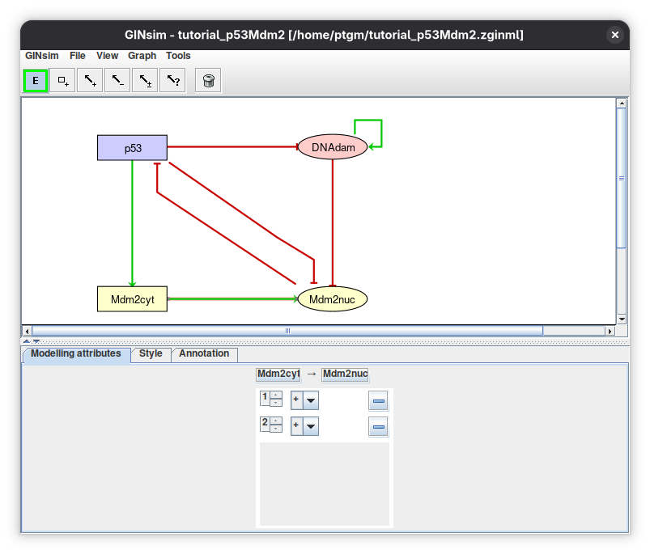{ width="640" }

    The regulatory graph and, in the bottom panel, the two interactions (thresholds 1 and 2) of the arc from Mdm2cyt to Mdm2nuc.

### Define the logical rules

1. Select a node (for instance DNAdam) and choose **Formulae** in the drop-down list at the bottom left of the *Modelling Attributes* tab.
2. Click the little arrow in the main bottom panel to expand the tree, and add a function for the target level (1 by default; change it for the multilevel nodes).
3. Click the **E** button to start editing (the line is highlighted), type the formula, and press **Enter** to validate it.
4. Repeat for the other components and target levels of the table of rules.

Several rows can be given for the same target level; they are combined with OR. The literals must exactly match the identifiers of the
regulators of the selected node. A component with no rule for a level stays at the value 0 for this level.

!!! example "Defining a rule"
    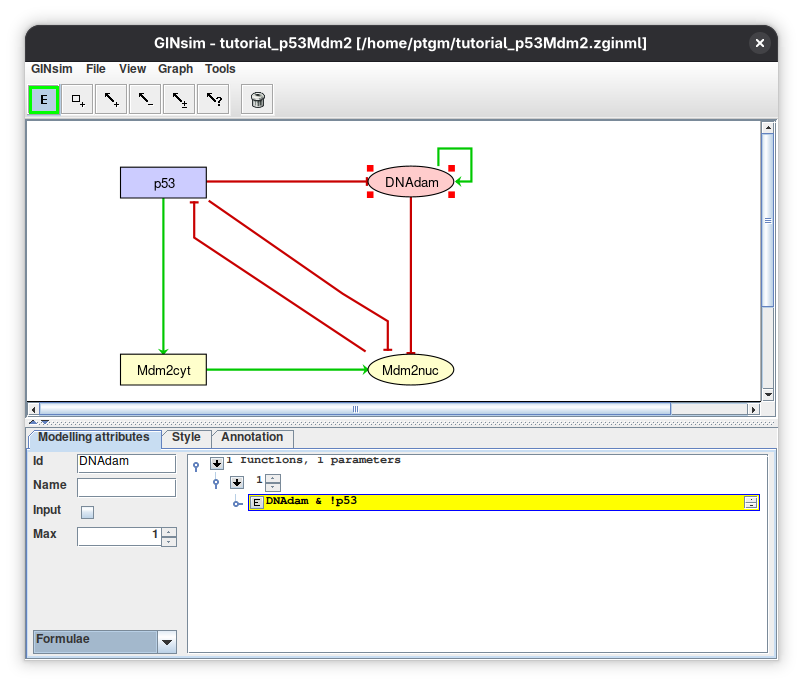{ width="640" }

    The rule `DNAdam & !p53` for the target level 1 of DNAdam: DNAdam is maintained at level 1 if already present, but only in the absence of p53.

### Annotate and save the model

Annotations (free text and links to databases such as `pubmed:19426782`) can be attached to the model, to each component and to each interaction.
Select an element and use the annotation panel (select the **Annotation** tab below).

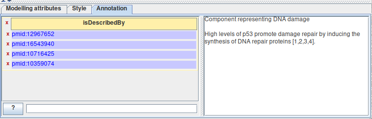{ width="480" }

Use **File → Save as…** to save your model in a `.zginml` archive: this keeps, together with the model, its perturbations, initial states and
simulation settings.

!!! tip "Save regularly"
    There is no undo functionality.

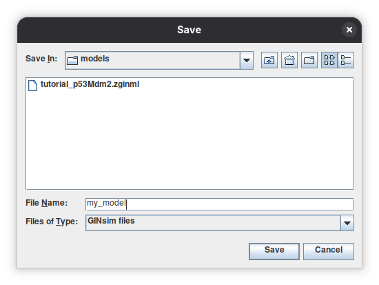{ width="420" }

### Check the consistency of the model

Before computing anything, check that the signs of the interactions you drew agree with what your rules really do.
Open **Tools → Interactions functionality** and click **Run**: GINsim recomputes, from the logical rules, the effect of each interaction in each
regulatory context, and compares it with the declared sign. For the model above, **all interactions are consistent** (they kept the original color).

Select a perturbation (optional), click **Run**, **Save a report**, and tick **Change/Restore LRG edge colours** to display the result on the graph.

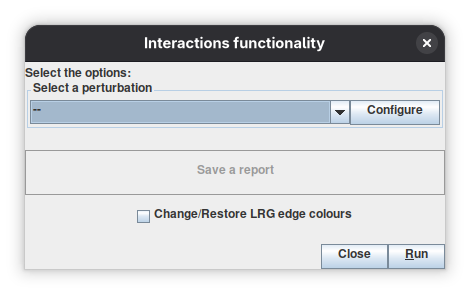{ width="400" }

    

!!! example "Exercise: find the typos"
    Introduce each of the following errors, run the tool again, and undo the change.

    1. In the rule of `Mdm2nuc`, delete `& !p53`. The interaction p53 → Mdm2nuc, declared as an inhibition, is now reported as **non-functional**: p53 no longer has any effect on Mdm2nuc.
    2. In the rule of `p53`, replace `!Mdm2nuc` by `Mdm2nuc`. The interaction Mdm2nuc → p53, declared as an inhibition, is now reported as a **positive** interaction.

    In both cases, the other interactions are not flagged.

!!! warning "Inconsistencies do not prevent simulation"
    GINsim does not forbid inconsistent models: they simulate normally. The tool is there to help you find mistakes. Remember also that a
    wrong threshold on a multilevel source is not an inconsistency of sign, so it may *not* be detected by this tool: check the thresholds
    of the interactions leaving multilevel components first when a result looks wrong.

### Stable states

A *stable state* is a state in which every component is already at its target level. Open **Tools → Compute stable states**
and click **Run**. GINsim searches all the stable states with an efficient algorithm that does not build the state transition graph.
You should find a **unique stable state**: `p53 = 0, Mdm2cyt = 1, Mdm2nuc = 1, DNAdam = 0` (written `0110` below, in the order of the components),
corresponding to the *rest state* of the cell: no p53, medium levels of cytoplasmic Mdm2, presence of nuclear Mdm2, no DNA damage.

If you obtain another stable state, or none, check carefully the maximal level of each node, the threshold of each interaction and each rule.

!!! example "Stable states"
    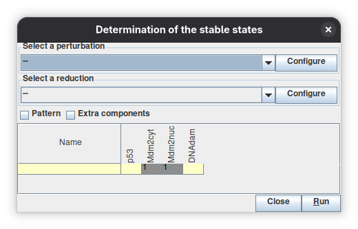{ width="460" }

    Yellow and grey cells denote the levels 0 and 1.

### Asynchronous dynamics

The state of the model is the vector of the levels of its components. In a given state, a component whose level differs from its target level is *called to update*,
by one unit toward its target. Under the **asynchronous** updating, each call gives a different transition: a state with *k* calls can originate *k* successors.

Open **Tools → Run simulation**. The default settings are those we want: *State Transition Graph*, *Asynchronous* updating, no perturbation, and
**no selected initial state**, which means that *all* the (3 × 3 × 2 × 2) 36 states are considered.

!!! example "Configuration of the simulation"
    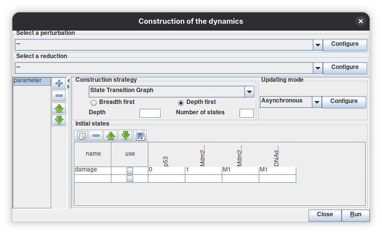{ width="640" }

    The panel shows, from top to bottom, the perturbation and the reduction (none here), the *Construction strategy*
    (state transition graph), the *Updating mode* (asynchronous) and the table of *Initial States*. One initial state `damage`
    (`0111`: p53 at 0, the others at their maximum, written `M1` for the nodes with a maximal level 1) has been defined but is not selected.
    The `+` button on the left stores several parameter settings.

Click **Run**, then display the graph in the new window. The stable state `0110` is at the bottom, and the states without incoming arcs are at the top. Select the
state `0200` (high Mdm2cyt, the three others at 0): its three successors are listed in the bottom panel, `1200` (p53 increases),
`0100` (Mdm2cyt decreases) and `0210` (Mdm2nuc increases). Click the arrows in the bottom panel to follow a path.

!!! example "The asynchronous state transition graph"
    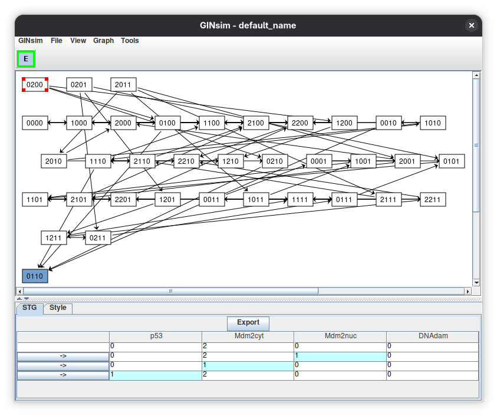{ width="640" }

    The unique stable state `0110` is at the bottom. The selected state `0200` is shown in the *STG* tab with its successors.

!!! warning "State space explosion"
    The number of states doubles with each additional Boolean node. Building the complete state transition graph is discouraged for more than about 15 nodes; for larger models, use the other tools and/or compressed graphs.

### Synchronous dynamics

Under the **synchronous** updating, all the components called to update change their levels simultaneously, in a single transition.
Run the simulation again, selecting *Synchronous* in the *Updating mode* menu.

!!! example "The synchronous state transition graph"
    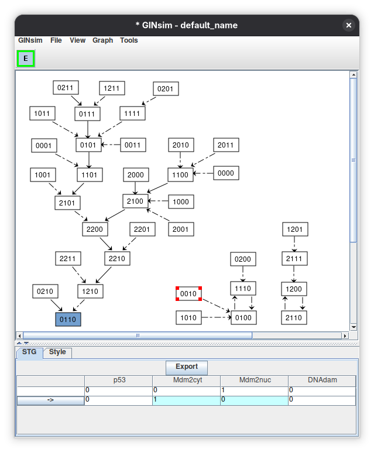{ width="560" }

    The layout was manually rearranged.

You should obtain **three disconnected graphs**: the stable state `0110`, which can be reached from 26 other states, and two **cyclic attractors of two states**
each, which did not exist under the asynchronous updating: `0100`↔`1110` (reached from 3 other states) and `1200`↔`2110` (reached from 2 other states).
This difference shows that the choice of the updating scheme matters.


### Compress the graph: the hierarchical transition graph

Go back and choose **Hierarchical Transition Graph** in the *Construction strategy* menu before running the simulation, selecting *Asynchronous* in the *Updating mode* menu.
The HTG has **6 nodes instead of 36**: groups of states are merged, while the attractors and the main dynamical properties are preserved.

!!! example "The hierarchical transition graph"
    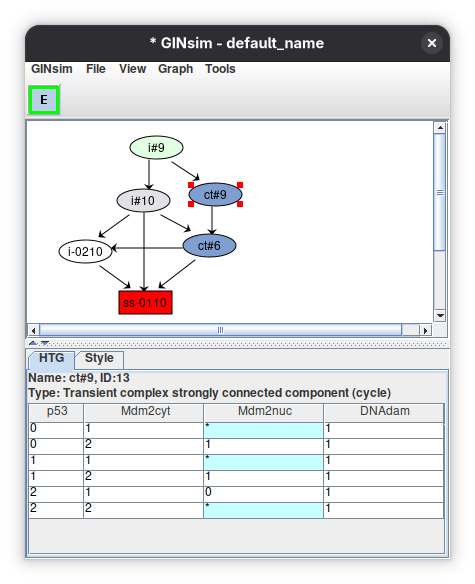{ width="520" }

    The stable state `ss-0110` is at the bottom (red). The two blue nodes, `ct#9` and `ct#6`, are *cyclic transient* components.

Click the node `ct#9`: the bottom panel lists the 9 states of this component, written as patterns where `*` stands for all the values of a component.
In all of them DNAdam = 1, while p53 oscillates between 0 and 2, Mdm2cyt between 1 and 2 and Mdm2nuc between 0 and 1:
this is the **large oscillations of p53 in the presence of DNA damage**. The node `ct#6` (6 states, DNAdam = 0, p53 and Mdm2cyt oscillating between 1 and 2)
corresponds to **smaller transient oscillations of p53 after DNA repair**. The other nodes (`i#9`, `i#10`, `i-0210`) are irreversible transient groups of states.

So, starting with DNA damage, the system first goes through large p53 oscillations, then the damage is repaired
along with smaller oscillations, and finally the cell returns to its rest state.

### Perturbations

*Gene knock-out* is modelled by fixing the level of a component to 0, and *ectopic expression* by fixing it to its highest level
(or to a range of levels for a multilevel component). Also, perturbations can be combined. Click the **Configure** button of any *Select a perturbation* panel
(simulation, stable states, circuits…) to open the perturbation editor, select the component **DNAdam**, the type *RANGE*, and *1 – Ectopic activity*, then click **Create**:
the perturbation `DNAdam E1` is now defined, and can be selected in the tools.

!!! example "Defining a perturbation"
    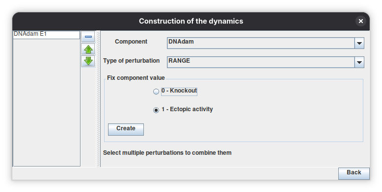{ width="520" }

    Ectopic expression of DNAdam: its level is blocked to 1.

Select `DNAdam E1` and compute the stable states again: there is **none**, the rest state `0110` is no longer a stable state.
Now run the simulation again with hierarchical transition graph: the attractor corresponds to **large oscillations of p53**, together with oscillations of the nuclear and cytoplasmic forms of Mdm2, in the presence of DNA damage.
It is made of the 9 states of the component `ct#9`.

### Trap-spaces
The *Trap-spaces identification* tool (**Tools** menu) gives a compact description of the attractors. Without perturbation, it returns a single trap-space, the stable state `0110`.
With the perturbation `DNAdam E1`, it returns the sub-space where DNAdam = 1 and Mdm2cyt ≥ 1, the other components being free.
Because trap-spaces approximate the attractors, this sub-space contains the 9 states of the oscillation.
This tool is specific to Boolean variables, so the multilevel components are split into Boolean variables (`p53_b1`, `p53_b2`, `Mdm2cyt_b1`, `Mdm2cyt_b2`) in the result table.

### Regulatory circuits

Regulatory circuits are responsible for the emergence of dynamical properties such as multistability (positive circuits) or sustained oscillations (negative circuits)
[@Thieffry2007]. But a circuit may be blocked by the other regulators of its components, rendering it not *functional*. Open **Tools → Analyse circuits** and click
**Search Circuits**, the regulatory graph contains **four circuits**. Then click **Functionality Analysis**: three of them are functional (one negative and two positive).
Select a circuit to display its sign and its *functionality context*, i.e. the conditions on the other regulators under which it operates [@Naldi2007].

!!! example "Circuit analysis"
    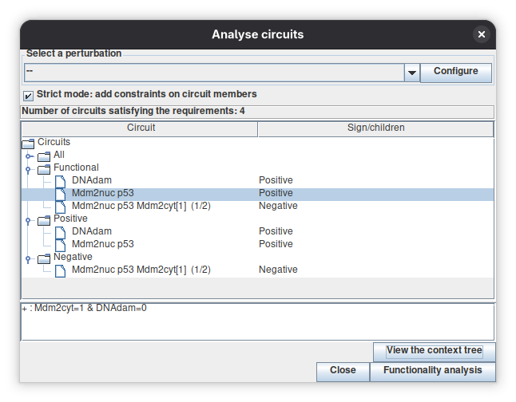{ width="460" }

    Among the four circuits, the negative circuit (p53, Mdm2cyt, Mdm2nuc), the positive self-loop of DNAdam and the positive circuit between p53 and Mdm2nuc are functional.
    The selected positive circuit, the cross-inhibition between p53 and Mdm2nuc, is functional when Mdm2cyt = 1 and DNAdam = 0.

Indeed, the inhibition of Mdm2nuc by p53 has no effect when there is DNA damage, when Mdm2cyt is at its highest level (Mdm2nuc is then active whatever the value of p53), or
when Mdm2cyt is absent. Circuits that differ only by the threshold of one interaction (here, level 1 or 2 of Mdm2cyt acting on Mdm2nuc) are grouped, and indicated with a tag such as `[1]` or `(1/2)`.


### Model reduction

When models grow, their state transition graph quickly becomes too large. A *reduction* hides some components and recomputes the rules of their targets, so that their indirect effects are kept, which
preserves the stable states and the more complex attractors [@Naldi2011].
Open **Tools → Reduce model**, click **+** to define a reduction, select the node **Mdm2cyt**, and click **Run**.

!!! example "Reduction of Mdm2cyt"
    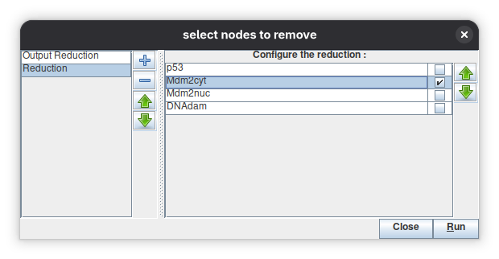{ width="520" }

    Only Mdm2cyt is selected for reduction. A reduction can also be defined here and then selected and applied directly by the other tools (*Select a reduction* panels).

The reduced model has three components. Mdm2nuc is now the target of a **dual interaction** from p53, which captures the indirect effect of p53 through Mdm2cyt:
Mdm2nuc is called to 1 if p53 is at level 2, or if p53 is absent and there is no DNA damage, and to 0 otherwise.
Select this reduction in the simulation dialog and run the asynchronous simulation: the graph has **12 states instead of 36**,
the rest state is kept, and the two kinds of p53 oscillations (large with damage, smaller after repair) are still there.

### What you have learnt

You defined a multilevel logical model, checked it, computed its stable states, explored its asynchronous and synchronous dynamics and compressed it,
applied a perturbation, analysed its regulatory circuits and reduced it. Part II applies the same tools, and others (colouring a state on the graph,
estimating the reachability of the attractors), to a larger model.

---

## Part II: analysing the mammalian cell cycle model

The model of Traynard *et al.* [^traynard] describes the core engine of the mammalian cell cycle with eleven components, among which the cyclins A, B, D and E, and the inhibitors Rb, p27 and the APC/C co-activators Cdh1 and Cdc20.
CycD is an input (the growth factor signal); Rb and p27 are ternary components. It extends the model of Fauré *et al.* [^faure].

Go to the [models/2016-mammal-cell-cycle/](../models/2016-mammal-cell-cycle/) in the model repository and download the `Traynard_MultiLevel_MamCC_Apr2016.zginml` model file.
Then in GINsim, **Open** and select the downloaded file 
(or click it in the *Recent files* of the Welcome dialog).

Here, we follow the analysis described in the GINsim 3.1 paper [^ginsim2026].

<!-- VERIFY: Figures 3A and 4A show an initial state "Quiescence" together with the fixed-input configurations "CycD_ON" and "CycD_OFF".
     The Apr 2016 file of the repository only contains the initial states "Quiescence", "Cycle" and "Quiescence2" and no fixed inputs:
     update the file in the repository, or keep the tip given in the section on the dynamics. -->

### Explore the model

The regulatory graph appears in the main window. Green arcs are activations and red arcs inhibitions;
rectangles are the multilevel components (Rb and p27), ellipses the Boolean ones, and the input CycD is shown in blue.
The bottom area has three tabs: **Modelling attributes**, **Annotations** and **Style**. With nothing selected, the *Annotations* tab
displays the annotation of the model itself.

!!! example "The regulatory graph of the cell cycle model"
    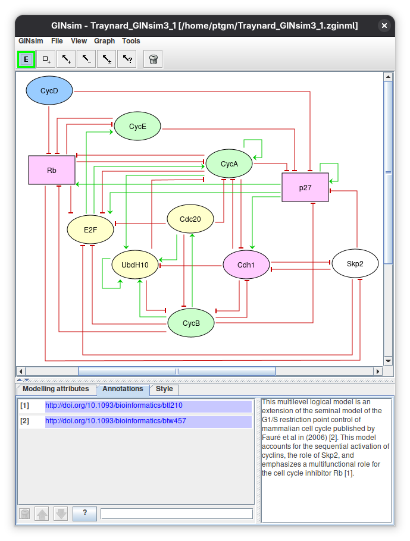{ width="480" }

    The *Annotations* tab of the model: a numbered list of two links, to the publications the model derives from, and a free text that cites them.

Select the component p27: the *Modelling attributes* tab shows its identifier, its maximal level (2) and, in the *Formulae* view, its logical functions, one per target value.

!!! example "The logical rules of p27"
    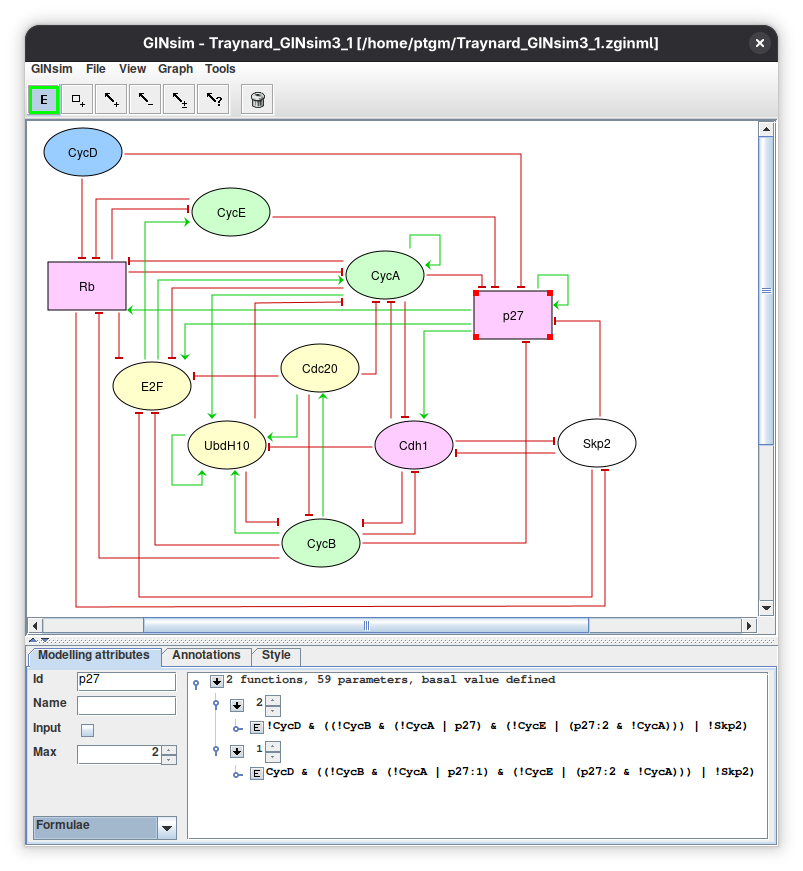{ width="560" }

    Two non-overlapping Boolean functions define the target values of the ternary component p27:
    the first enables the value 2 and the second the value 1.

The complete rules are listed in a table in the GINsim 3.1 article [^ginsim2026]. Use **View → Layout** if you want to rearrange the graph, and
**Graph → Find path** or **Graph → Highlight local graph** to explore the neighbourhood of a component.

### Check the interaction signs

As in Part I, run **Tools → Compute interaction functionality**. For this model, the 40 interactions of the graph
are consistent with the logical rules: nothing is flagged. The two ternary components deserve a closer look at their rules:
the five regulators CycA, CycB, CycD, CycE and Skp2 inhibit p27, which activates itself at both of its levels, while CycA, CycB, CycD and CycE inhibit Rb,
which is activated by p27 at its first level only (going from level 1 to level 2 of p27 changes nothing for Rb).

!!! example "Exercises"
    Introduce one of the following errors, run the tool again, and undo the change (**do not save** the modified model).

    1. In the rule of `CycB`, replace `!Cdh1` by `Cdh1`. Only the interaction `Cdh1 → CycB` is flagged: declared as an inhibition,
       it is now reported as a **positive** interaction.
    2. In the rule of `CycE`, delete `& !Rb`. Only the interaction `Rb → CycE` is flagged, as **non-functional**.

    A mistake in a multilevel rule can have a larger footprint: if, in the rule of `p27` for the target value 2, you replace `!CycD` by `CycD`, the two rules of p27
    overlap, and all the interactions targeting p27 are reported as non-functional.

### Compute the attractors

Open **Tools → Trap-spaces identification**. **Trap-spaces** are sub-spaces of the state space
that the dynamics cannot leave; the *minimal* ones contain the stable states and give an approximation of the other attractors
(see the [documentation](/documentation/) and [@Klarner2014]). The dialog proposes, as most tools, a *perturbation*,
a *model reduction* and an *input restriction*. Click **Run** with the default settings.

The result table contains one line per trap-space; the columns are the Boolean variables of the model
(the ternary components Rb and p27 are split in two variables, `_b1` and `_b2`, because the algorithm works on Boolean models: GINsim
converts the model transparently, see [Booleanisation](#other-tools)).
Empty yellow cells are variables fixed to 0, grey cells with a `1` are fixed to 1, and blue cells marked `*` are free.

!!! example "Trap-spaces of the wild-type model"
    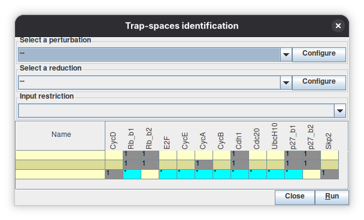{ width="460" }

    Three trap-spaces. The first two lines are stable states with all the cyclins inactive (CycD absent),
    which differ by the activity of CycA: the first is the quiescent state, the second is a spurious stable state
    pointing to incomplete knowledge on the regulation of cyclin A. In the third line, CycD and Skp2 are fixed to 1, and nine variables are free:
    this is a cyclic attractor, with CycD active and nine oscillating components.

!!! tip "Trap-spaces approximate the attractors"
    The cyclic trap-space of the third line has nine free variables, hence 2^9 = 512 states, whereas the cyclic attractor itself has
    270 states (see the simulation below): a trap-space contains the attractor, but can be larger.

Now select the perturbation `Rb KO, E2F E1` (Rb knocked out, E2F ectopically activated) and run again: the
quiescent state disappears and there remain two cyclic attractors, which differ by the value of CycD:
the model predicts cell cycle oscillations even without growth factors.

!!! example "Trap-spaces with a double perturbation"
    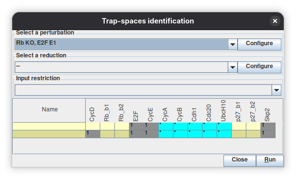{ width="460" }

### Display a state on the regulatory graph

Open **Graph → Colour LRG**. This tool has four tabs (*By state*, *By stable states*, *By trap spaces* and *By max values*) to colour the regulatory graph
depending on the state of each regulator. Select the perturbation `p27 KO, Skp2 KO`, click the **By stable states** tab,
then **Get the stable states**: the table shows the stable state returned (Rb = 2, Cdh1 = 1, all the other components inactive).
Select it and click **Run**. With *Change/Restore LRG edge colours* ticked, the active components are coloured in the graph and the interactions
they exert are highlighted: this is very handy to read a state on a large network. Untick the box and run again to restore the original colours.

!!! example "Colour LRG"
    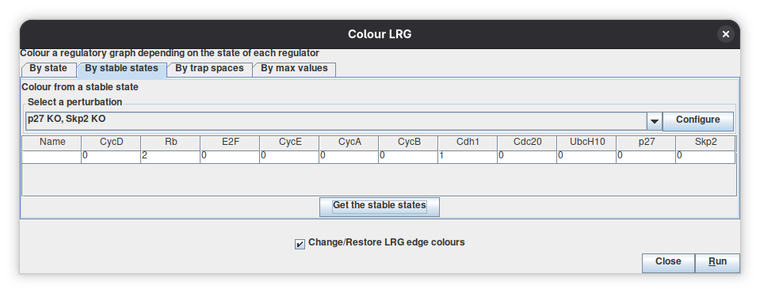{ width="640" }

    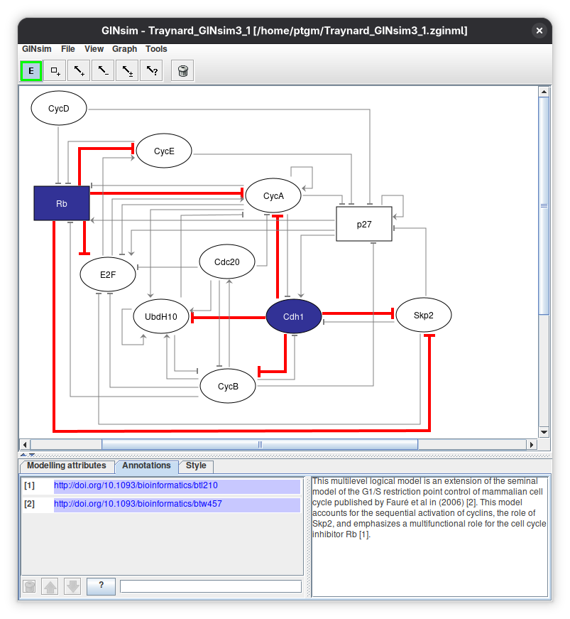{ width="520" }

    Active nodes (Rb and Cdh1) in dark blue and inactive nodes in white; the interactions exerted by the active nodes (all inhibitions) are in thick red,
    the others in grey.

### Explore the dynamics: state transition graphs and their compressions

Open **Tools → Run simulation**. This dialog lets you choose

* a perturbation, a model reduction and an input restriction;
* the **updating mode** (here *Asynchronous*; other modes are synchronous, complete, or based on priority classes);
* the **type of graph**: the full *State Transition Graph* (STG), the *Strongly Connected Components Graph* (SCCG)
  or the *Hierarchical Transition Graph* (HTG), these last two being compressed during the computation, which allows to
  handle much larger models;
* the exploration strategy (depth-first or breadth-first) and limits on the depth or the number of visited states;
* the **initial states** and the values of the **inputs**. Rows can be added, removed and reordered with the buttons
  above each table. A row can fix some components and leave the others free.

The list on the left stores named configurations of the dialog (here, one per perturbation or updating mode), so that a simulation can be reproduced with a single click.

!!! example "Configuration of a simulation"
    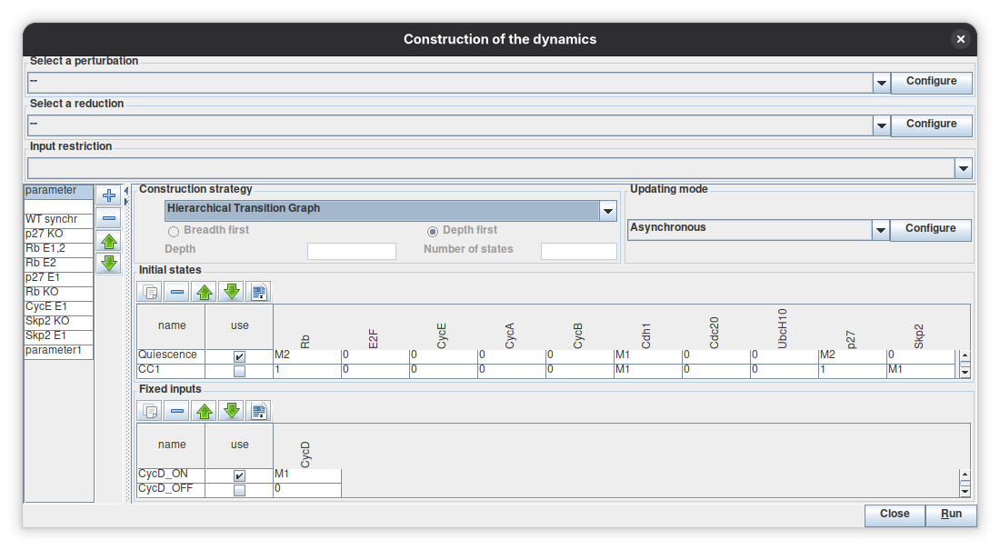{ width="700" }

    HTG, asynchronous updating, initial state *Quiescence* (ticked) combined with the input configuration *CycD_ON* (ticked; CycD = 1): a quiescent
    cell exposed to growth factors. The other initial state (*CC1*) and the input configuration *CycD_OFF* are not used.

!!! tip "If the model you opened has no CycD_ON / CycD_OFF"
    The configurations *CycD_ON* and *CycD_OFF* are rows of the *Fixed inputs* table: one row per configuration, with the value of the input CycD
    (1 for *CycD_ON*, 0 for *CycD_OFF*). Add rows with the buttons above the table, give them these names, and tick the one to be used.

<!-- VERIFY: exact buttons (add / duplicate / remove / reorder) of the "Initial states" and "Fixed inputs" tables and how a new row is created. -->

Click **Run**. The result is a new window with the compressed graph. The upper node groups the 11 transient states
(including the initial one, `i` is for "irreversible"), which all lead to the lower node: a complex cyclic attractor of **270 states**,
the proliferating cell cycle. Click a node: the bottom panel (*HTG* tab) gives its name, its type (here *Terminal complex strongly connected component (cycle)*)
and the list of its states as a series of patterns, where `*` denotes a free component.
The functionalities of the contextual **Tools** menu (for instance *Expand SCC&HTG nodes*) expand a node into the corresponding STG, or compute the transitions between nodes.

!!! example "The hierarchical transition graph"
    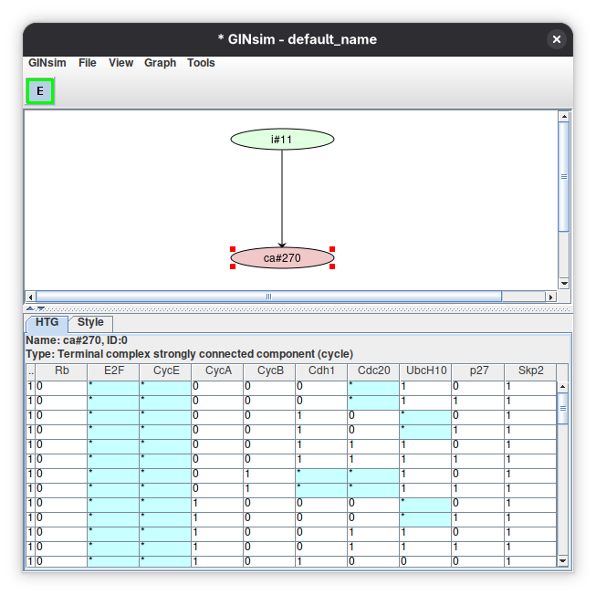{ width="440" }

    The node `ca#270` is selected. The asterisk in the title of the window indicates a graph that has not been saved.

!!! tip "SCC graph and path tools"
    Compressed graphs can also be obtained for any existing graph with **Graph → Construct SCC Graph**
    (and *Colour SCC* colours the components without building it), and **Graph → Find path**, or the
    animation of a path in an STG, help to follow one specific trajectory.


### Estimate which attractor is reached, and with which probability

State transition graphs of large models cannot always be built. The **Assess attractor reachability** tool
(Tools menu) estimates by sampling asynchronous trajectories how likely each attractor is to be reached from a set of initial conditions,
without building the whole graph. Two algorithms are proposed: plain Monte Carlo sampling and **Avatar** [@Mendes2018], which handles better the
trajectories trapped in large cyclic attractors.

The window (titled *Attractors reachability*) is organised as follows:

* **Simulation**: the algorithm (here Avatar) and, for Avatar, its parameters: the number of runs (1000), the limits on the number of states expanded (`1E4`) and
  rewired (`1E3`), and the rewiring mode (*Exact exit probabilities*). The *Expert parameters* are left to their default values;
* **Model modifications**: the perturbation, the reduction and the input restriction (none here);
* **Initial states** and **Fixed inputs**: no initial state is ticked, so the internal components are left free, and both input configurations *CycD_ON* and
  *CycD_OFF* are ticked, which means that CycD is switched ON or OFF, its value being sampled for each run.

!!! example "Configuration of the attractor reachability analysis"
    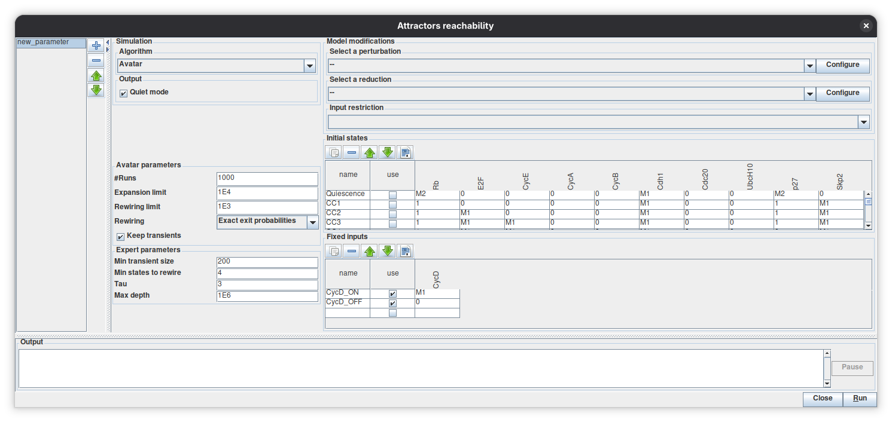{ width="700" }

Click **Run**. When the computation ends, an output window reports the parameters, the initial conditions and the estimated probabilities.
The results can be saved as HTML or CSV files, and the button **Plot: convergence of probability estimates** displays how
the estimates stabilise during the runs.

!!! example "Results"
    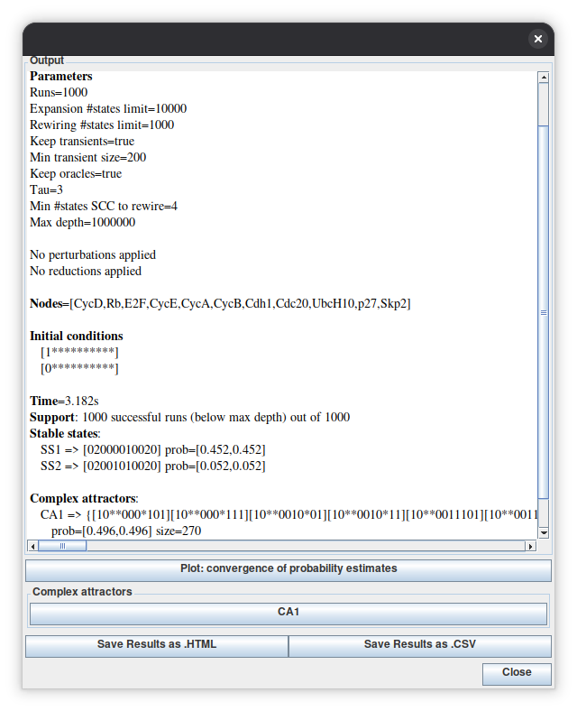{ width="400" }
    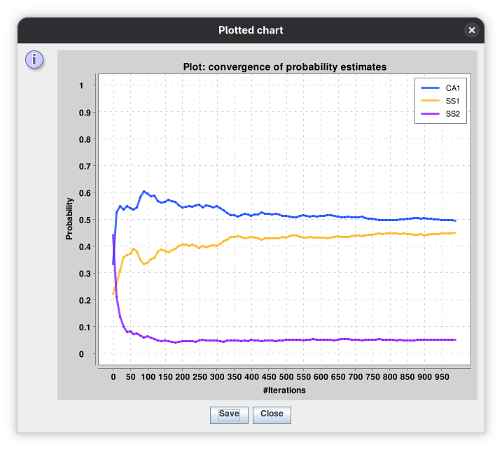{ width="420" }

    The initial conditions are `[1**********]` and `[0**********]`: CycD ON or OFF, all the other components free.
    The two stable states SS1 and SS2 (the first two lines of the trap-space table) are reached with probabilities of about
    0.45 and 0.05, and the cyclic attractor CA1 (270 states) with a probability of about 0.50.

The states are written as vectors, in the order given by *Nodes* (CycD, Rb, E2F, CycE, CycA, CycB, Cdh1, Cdc20, UbcH10, p27, Skp2). For instance, `SS1 = [02000010020]`
is the quiescent state (Rb = 2, Cdh1 = 1, p27 = 2, all the others at 0), and `SS2` is the same state with CycA = 1. Each probability is reported as an interval (`prob=[0.452,0.452]`), reduced here to a single value.

<!-- VERIFY: "reported as an interval": the two numbers of prob=[..,..] look like lower and upper bounds of the estimate (to be confirmed with the Avatar paper). -->

!!! warning "Read the probabilities with the input in mind"
    CycD is an input: its value never changes during a run, and it decides which attractors can be reached
    (stable states for CycD = 0, the cyclic attractor for CycD = 1). The 0.50 / 0.50 split between the cyclic attractor (0.496) and the stable states
    (0.452 + 0.052) thus mostly reflects how CycD was sampled. The informative quantity is the probability **conditional on the value of the input**.

!!! example "Exercise: condition on the input"
    Untick *CycD_ON* so that only *CycD_OFF* is used, and run Avatar again. All the trajectories now end in the two stable states.
    You should find that around 90 % reach the quiescent state (SS1) and around 10 % the spurious state with CycA active (SS2)
    (from the figure above: 0.452 / (0.452 + 0.052) ≈ 0.90).
    With only *CycD_ON*, all the trajectories reach the cyclic attractor.

<!-- VERIFY: the conditional values were also obtained by an exact computation (absorption probabilities of the asynchronous dynamics, uniform choice among the enabled updates,
     uniform distribution of the initial states): CycD = 0, SS1 0.906, SS2 0.094; CycD = 1, a unique attractor of 270 states reached with probability 1.
     Re-run Avatar with CycD_OFF only (and more runs) to confirm. -->


### Identify the regulatory circuits that matter

**Regulatory circuits** are closed paths of interactions; they are *positive* or *negative* depending on the parity of the number of
inhibitions. Positive circuits are required for multistability, negative circuits for sustained oscillations [@Thieffry2007].
Large graphs have many circuits, but only some of them are *functional*, i.e. can operate in some context given the logical rules.
GINsim computes, for each circuit, its **functionality context** [@Naldi2007].

Open **Tools → Analyse circuits**. The first dialog allows to restrict the search to circuits of a given length range (here from 1 to 11 components, the number of components of the model) or involving
required or excluded components (all circuits are considered by default). Click **Search Circuits**.

!!! example "Search of circuits"
    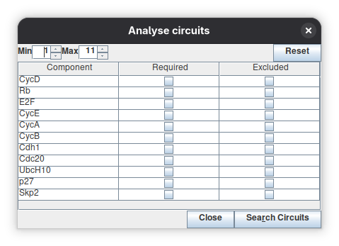{ width="360" }

The next window lists the circuits found (264 for this model). Select a perturbation, for example **CycD E1** (growth factor present), tick
*Strict mode* if you want constraints on the members of the circuits, and click **Functionality analysis**. The
circuits are then classified by sign and the functionality context of the selected circuit is displayed at the bottom
(for instance, the negative circuit between CycB and Cdc20 is functional when Cdh1 = 0 and UbcH10 = 1).

!!! example "Functional circuits"
    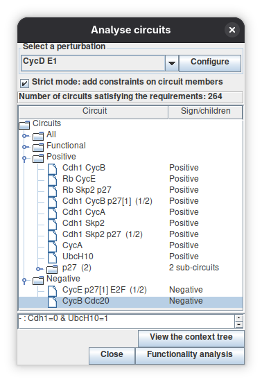{ width="300" }

    Two functional negative circuits (CycB–Cdc20, and p27–E2F–CycE) and ten functional positive circuits.
    The circuit `CycB Cdc20` is selected, and its context (`- : Cdh1=0 & UbcH10=1`) is displayed below the list.

Entries such as `Cdh1 CycB p27[1] (1/2)` and the folder `p27 (2)` (*2 sub-circuits*) group circuits that differ only by the threshold of one interaction.

<!-- VERIFY: description of the tags [1], (1/2) and "n sub-circuits" (circuits differing by an interaction threshold), inferred from the lists of circuits. -->

To emphasise circuits in the regulatory graph, as in the figure below, define **edge styles** in the *Style* tab (*Edges*): here *Thick Negative* (red, `#c80000`, line width 4)
and *Thick Positive* (green, `#00c800`, line width 4), and apply them to the arcs of the circuits.

<!-- VERIFY: the screenshots of Figure 5C-D show these two custom edge styles in the Style tab. Check whether selecting a circuit in the list also selects or highlights its arcs
     in the graph, and adapt the sentence above. -->

!!! example "Circuits on the regulatory graph"
    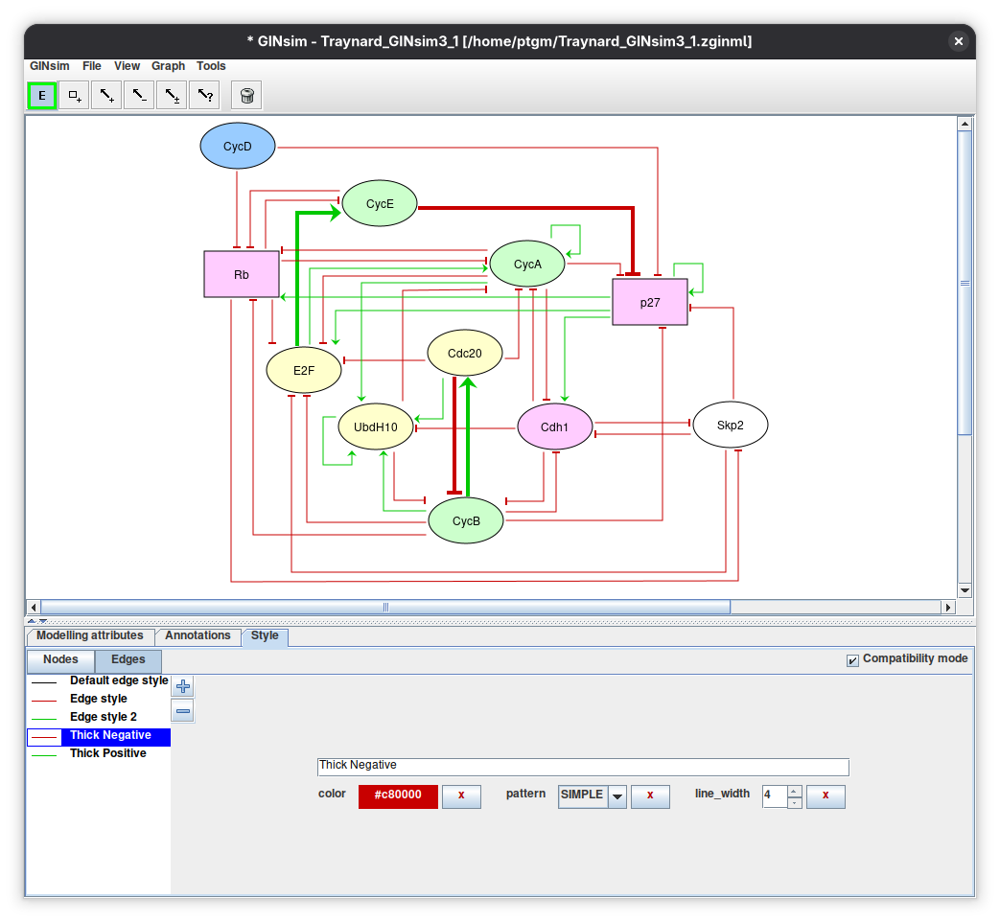{ width="420" }
    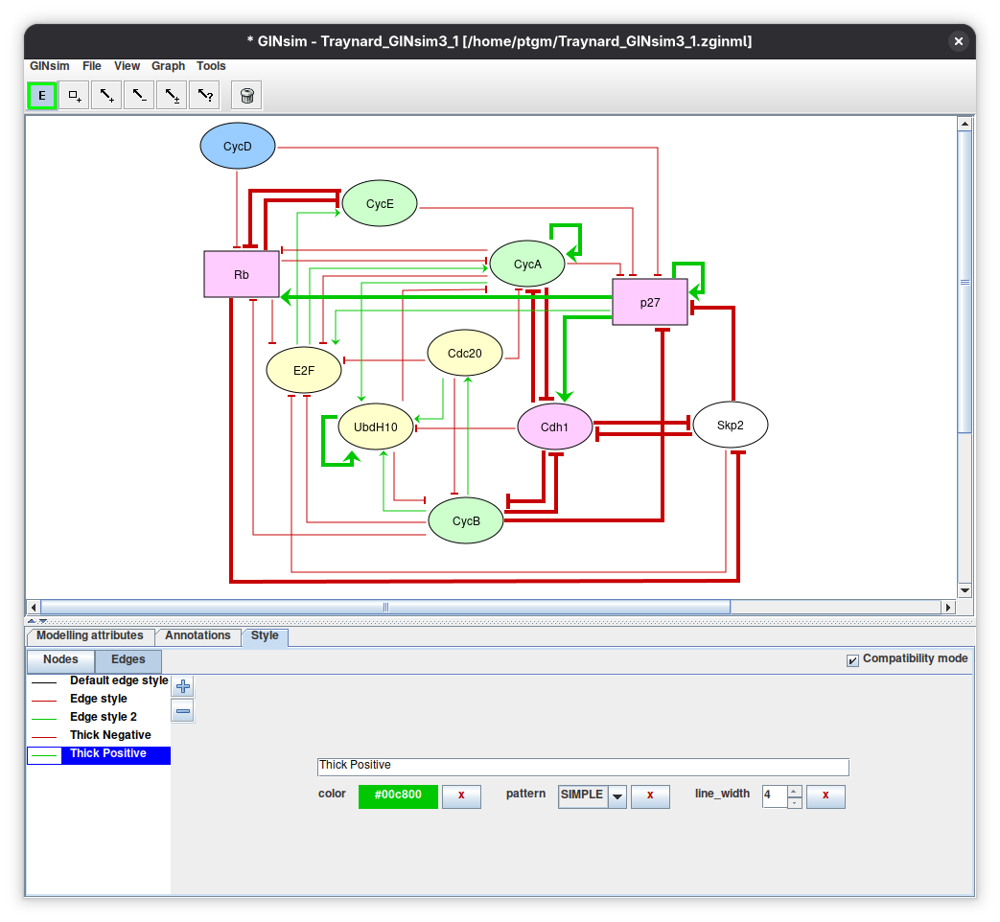{ width="420" }

    Functional negative circuits (left, thick arcs) are those that can generate the oscillations of the cell cycle; functional
    positive circuits (right) presumably support irreversible decisions along the cycle.

---

## Other tools

These tools are not needed for the examples above, but you will often use them on larger models.

**Booleanisation** (*Tools → Booleanize model*). Converts a multilevel model into an equivalent Boolean model,
by mapping a component of maximal level *m* onto *m* Boolean variables. It is applied implicitly when a
Boolean-only tool, such as the trap-space identification, or a Boolean-only export format is used on a multilevel model.

**Model reversal** (*Tools → Compute reversed model*). Builds a model whose asynchronous successors are the predecessors of the
original model, which allows to compute the states leading to an attractor by exploring its forward dynamics in the reversed model.

**Strongly connected components** (*Graph → Construct SCC Graph*, *Colour SCC*, and *Tools → Expand SCC&HTG nodes*). Compute or just colour
the strongly connected components of a graph (regulatory graph or state transition graph); the SCC graph is acyclic and gives a compact view of
its organisation. *Expand SCC&HTG nodes* recovers the original graph for a selection of nodes of an SCC graph or of an HTG, by launching a new simulation
limited to the corresponding sub-space.


---

## Going further

* **Exports.** Export your model to other tools from *File → Export* (see the table of formats in the [Documentation](/documentation/)).
* **Scripts and notebooks.** The core algorithms are implemented in the bioLQM library [@Naldi2018biolqm] and are available, with
  many other tools, in the [CoLoMoTo Interactive Notebook](https://colomoto.github.io/) environment, which lets you
  chain GINsim analyses with other tools in reproducible Jupyter notebooks. A short example is given below.
* **More models.** The [model repository](/models/) gathers published logical models, each with its model file(s), ready to open in GINsim.
* **Questions and bugs.** See the [contact page](/contact/) and the [GitHub repository](https://github.com/GINsim/GINsim).

### A scripting example

The following Python commands reproduce some results of Part I (stable state, then ectopic expression of DNAdam):

```python
import ginsim, biolqm

lrg = ginsim.load("tutorial_p53Mdm2.zginml")     # the model of Part I
lqm = ginsim.to_biolqm(lrg)

biolqm.fixpoints(lqm)
# [{'p53': 0, 'Mdm2cyt': 1, 'Mdm2nuc': 1, 'DNAdam': 0}]   (the rest state)

pert = biolqm.perturbation(lqm, "DNAdam%1")     # ectopic expression of DNAdam
biolqm.fixpoints(pert)
# []                                             (no stable state)

biolqm.trapspace(pert, "terminal bdd")
# a single trap-space: DNAdam = 1, Mdm2cyt >= 1, the other components free
```

---

## Troubleshooting

If you obtain unexpected dynamical results (stable states or simulations), check successively:

1. the structure of the regulatory graph (missing or wrong interactions);
2. the maximal levels of all components;
3. the thresholds of the interactions leaving multilevel components;
4. the logical rules, and the signs of the interactions with **Compute interaction functionality**.

| Symptom | Likely cause |
|---------|--------------|
| The *Input* box of a component is disabled | The component has incoming interactions or rules: remove them first |
| A rule is highlighted | The rule uses interactions that are not defined for this regulator or that have disjoint ranges |
| A multilevel regulator seems to be ignored | The interaction threshold does not match the level used in the rule (`X` vs `X:2`) |
| The trap-space table has more columns than components | Multilevel components are split into Boolean variables (`_b1`, `_b2`) |
| Probabilities of reachability depend on the input | The input is sampled: condition on the value of the input |

---

## How to cite

If you use GINsim 3.1, please cite the article indicated in the [how to cite page](../howtocite/).

- The p53–Mdm2 example of Part I is adapted from Naldi *et al.* [^naldi2018].

- The mammalian cell cycle core engine of Part II is adapted from Traynard *et al.* [^traynard].


## References

[^naldi2018]: Naldi A, Hernandez C, Abou-Jaoudé W, Monteiro PT, Chaouiya C, Thieffry D. Logical modeling and analysis of cellular regulatory networks with GINsim 3.0. *Front. Physiol.* 9:646 (2018). [doi:10.3389/fphys.2018.00646](https://doi.org/10.3389/fphys.2018.00646)

[^traynard]: Traynard P, Fauré A, Fages F, Thieffry D. Logical model specification aided by model-checking techniques: application to the mammalian cell cycle regulation. *Bioinformatics* 32(17):i772–i780 (2016). [doi:10.1093/bioinformatics/btw457](https://doi.org/10.1093/bioinformatics/btw457)

[^faure]: Fauré A, Naldi A, Chaouiya C, Thieffry D. Dynamical analysis of a generic Boolean model for the control of the mammalian cell cycle. *Bioinformatics* 22(14):e124–e131 (2006). [doi:10.1093/bioinformatics/btl210](https://doi.org/10.1093/bioinformatics/btl210)

[^ginsim2026]: Tichit L, Benielli D, Chabrol O, Thieffry D, Chaouiya C, Monteiro PT. GINsim 3.1: Qualitative modelling and dynamical analysis of logical regulatory networks. *in preparation*
